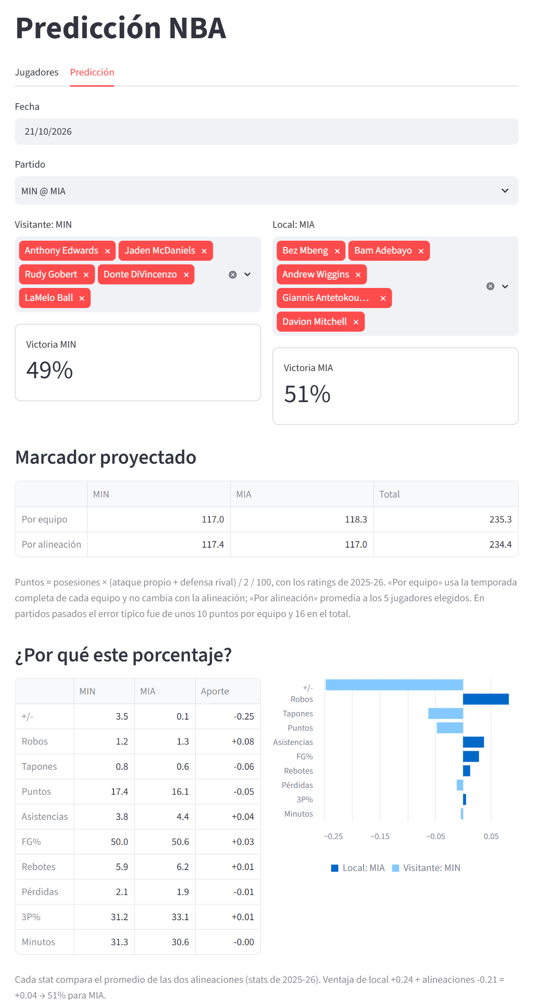
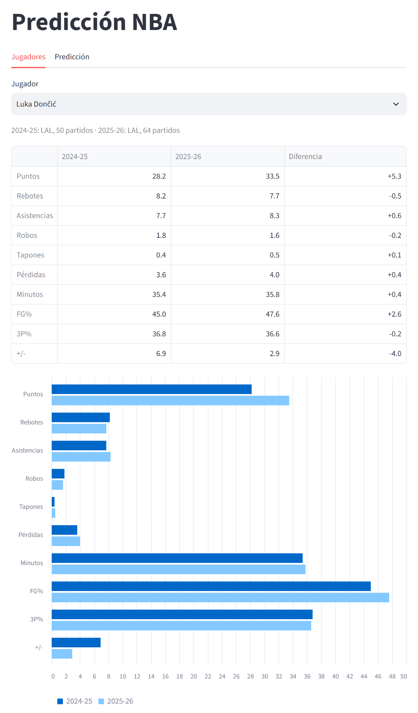
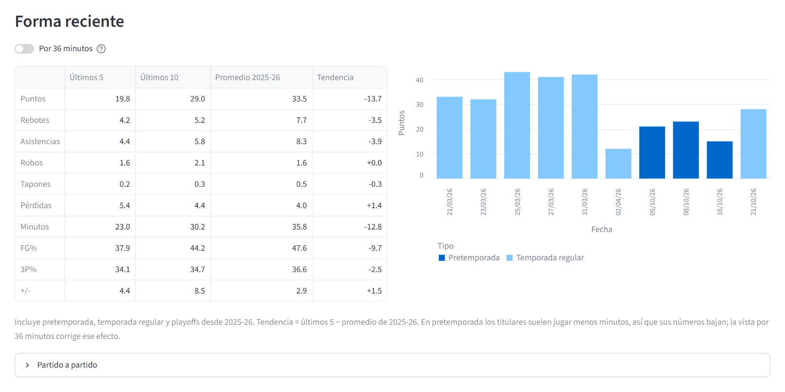
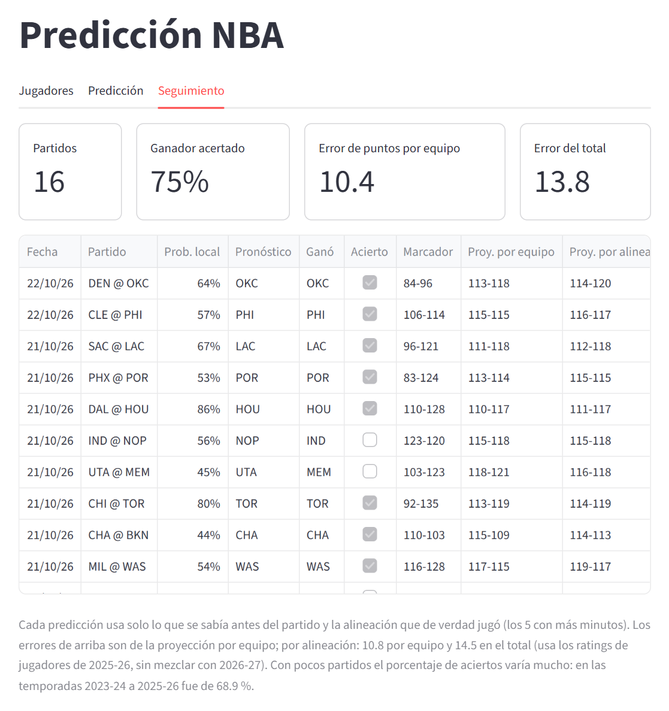

# Predicción NBA por alineación


[](LICENSE)

Predice el porcentaje de victoria y el marcador de un partido de la temporada **2026-27** según los 5 jugadores que elijas.
Usa una regresión logística entrenada con las stats individuales de los jugadores, la banca, el Elo de cada equipo y si jugó el día anterior,
y una proyección de puntos basada en efectividad ofensiva, defensiva y posesiones. La alineación sugerida deja fuera a los lesionados según el
reporte de ESPN. Todo mezcla la temporada pasada con lo que va de la actual, y la app lleva el seguimiento de sus aciertos y de cómo le va
contra los momios de la casa.



## Qué hace

- **Jugadores**: compara las stats por partido de un jugador entre 2024-25 y 2025-26, y muestra su **forma reciente**:
  promedio de los últimos 5 y 10 partidos (pretemporada, temporada regular y playoffs), la tendencia frente a su promedio
  de la temporada pasada, una vista **por 36 minutos** y el detalle partido a partido.
- **Predicción**: eliges una fecha y un partido del calendario 2026-27, armas la alineación de cada equipo y ves el porcentaje de victoria,
  los puntos proyectados de cada equipo y el total del partido. Por defecto se sugieren los 5 jugadores con más minutos esperados que no
  están **fuera por lesión**; debajo de cada selector se listan los lesionados (fuera y en duda) con su regreso estimado.
  Un **cara a cara** muestra las stats clave de toda la plantilla disponible de cada equipo (temporada, últimos 5 o últimos 10 partidos, también
  por 36 minutos): primero los 5 elegidos con su promedio y luego la banca con el suyo. Debajo, qué datos inclinan la balanza hacia cada equipo.
- **Jornada**: todos los partidos de un día en una sola página, cada uno con su alineación, porcentaje de victoria y momio justo.
  Escribes los momios de la casa, tu bank y a quién le apuestas, y la app sugiere cuánto meterle con el criterio de Kelly.
  Los momios se guardan solos para compararlos después con el resultado.
- **Seguimiento**: compara cada predicción con el resultado real de los partidos ya jugados de 2026-27, y el modelo contra el mercado
  en los partidos donde guardaste momios.
- **Actualizar datos**: el botón de arriba descarga lo de la temporada actual sin cerrar la app.







## Resultados

Cada temporada se predice con un modelo entrenado solo con las temporadas anteriores y, en cada partido, con lo que se sabía antes de jugarlo:

| Temporada de prueba | Entrenamiento | Modelo | Log loss | Siempre gana el local |
|---|---|---|---|---|
| 2023-24 | 2021-22 a 2022-23 | 67.2 % | 0.596 | 54.3 % |
| 2024-25 | 2021-22 a 2023-24 | 68.9 % | 0.587 | 54.4 % |
| 2025-26 | 2021-22 a 2024-25 | 69.0 % | 0.579 | 55.4 % |
| **Promedio** | | **68.4 %** | **0.587** | 54.7 % |

El log loss mide qué tan buenas son las probabilidades y no solo si se acertó al ganador (menos es mejor). Importa para apostar:
el tamaño de la apuesta depende de que un 70 % sea de verdad 70 %.

El modelo final, el que usa la app para 2026-27, se entrena con los 6,150 partidos de 2021-22 a 2025-26.

| Versión | Aciertos | Log loss |
|---|---|---|
| Anterior: los 5 con más minutos en el partido (eso se sabe hasta después) | 68.9 % | 0.591 |
| Los 5 con más minutos esperados entre los que jugaron (lo que se sabe con el reporte de lesiones) | 68.1 % | 0.591 |
| **+ banca, Elo y back-to-back (actual)** | **68.4 %** | **0.587** |

La versión anterior acertaba un poco más porque sabía cuántos minutos jugó cada uno, algo que no se conoce antes del partido.
Sin saber quién falta (los 5 habituales aunque alguno esté lesionado) el acierto baja a cerca de 66 %: revisar las lesiones es lo que más ayuda.
También se probaron la distancia de viaje, el cambio de huso horario, la altura de Denver y Utah, y la forma de los últimos 10 partidos:
ninguno mejoró el modelo.

## Cómo funciona

1. **Alineación**: en cada partido histórico se toman, de los jugadores que jugaron, los 5 con más minutos esperados antes del partido
   (la misma regla que la alineación sugerida de la app); la **banca** son los 3 siguientes. Es lo que elegiría alguien que revisó el reporte de lesiones.
2. **Features**:
   - la diferencia local − visitante del promedio de PTS, REB, AST, STL, BLK, TOV, MIN, FG%, 3P% y +/- de esos 5 jugadores;
   - la diferencia del promedio de puntos y +/- de la banca;
   - la diferencia de **Elo**: una calificación de cada equipo que sube al ganar y baja al perder, más cuanto mayor el margen y menos
     cuando gana el favorito (al estilo de FiveThirtyEight). Resume cosas que no están en las stats de los jugadores, como el sistema
     del entrenador. Al empezar cada temporada, cada equipo regresa un 25 % hacia el promedio;
   - si el local y si el visitante jugaron el día anterior (**back-to-back**). De 2021-22 a 2025-26 el local ganó el 55.8 % de los
     partidos sin back-to-back, el 45.9 % cuando solo él venía de jugar y el 60.0 % cuando solo el visitante venía de jugar.
3. **Temporada anterior + temporada en curso**: las stats de cada jugador mezclan su temporada anterior con lo que llevaba
   de la actual antes de ese partido. La actual pesa más con cada partido jugado: a los 10 partidos, mitad y mitad
   (elegido con la versión anterior del modelo, que solo usaba las stats de los 5 con más minutos):

   | Peso de la temporada en curso | Aciertos (2023-24 a 2025-26) |
   |---|---|
   | Ninguno (solo temporada anterior) | 66.1 % |
   | **Mitad y mitad a los 10 partidos** | **68.9 %** |
   | Mitad y mitad a los 5 o 20 partidos | 68.4 % / 68.6 % |

   Nunca se usan las stats del partido que se predice: los promedios de la temporada completa ya incluyen su resultado e inflan el acierto de forma artificial.
4. **Modelo**: regresión logística sobre las diferencias estandarizadas, con regularización elegida por validación cruzada.
   Las stats están muy correlacionadas (PTS y MIN: 0.90) y, sin regularización, el modelo repartía el peso entre ellas al azar.

   ```
   z = ventaja de local + Σ peso × diferencia estandarizada
   P(gana el local) = 1 / (1 + e^(−z))
   ```

5. **Jugadores que no jugaron la temporada anterior** (por ejemplo, por una lesión) usan sus stats de la temporada previa a esa.
   Los que no tienen ninguna de las dos (novatos) parten como un jugador de banca promedio (menos de 15 minutos por partido) hasta que acumulan partidos.

### Cuánto pesa cada dato

| Dato | Peso | Importancia |
|---|---|---|
| +/- | +0.32 | 22 % |
| Elo | +0.24 | 16 % |
| Puntos | +0.14 | 9 % |
| Local jugó ayer | −0.11 | 8 % |
| Rebotes | +0.11 | 7 % |
| Banca: +/- | +0.10 | 7 % |
| Robos | +0.07 | 5 % |
| Banca: puntos | +0.07 | 5 % |
| Visitante jugó ayer | +0.07 | 5 % |
| Tapones | +0.07 | 5 % |
| Asistencias | +0.06 | 4 % |
| Minutos | +0.06 | 4 % |
| 3P% | +0.03 | 2 % |
| Pérdidas | +0.00 | 0 % |
| FG% | +0.00 | 0 % |

El peso es el cambio en `z` por cada desviación estándar de diferencia entre los equipos; la ventaja de local vale +0.25.
El +/- de los jugadores y el Elo del equipo son lo que más pesa. Un back-to-back del local le quita más que lo que le suma uno del visitante:
un local con 58 % baja a 50 % si jugó ayer, y sube a 62 % si el que jugó ayer es el visitante.

### Alineación sugerida

Se sugieren los 5 jugadores con más **minutos esperados**: el promedio de minutos de las dos temporadas anteriores, ponderado por
partidos jugados (con 20 partidos ficticios de 10 minutos para que una muestra corta no pese de más), mezclado con los minutos de esta
temporada, que pesan mucho desde el primer partido. Es la regla que mejor acertó a los 5 con más minutos de cada partido en 2024-25 y
2025-26 (3.97 de 5): no deja fuera a una estrella que se perdió media temporada por lesión ni sube a un jugador con pocos partidos.

Los jugadores que el [reporte de lesiones de ESPN](https://www.espn.com/nba/injuries) marca como **fuera** no se sugieren (para partidos
futuros, vuelven a estar disponibles desde su fecha de regreso estimada). Los que están **en duda** sí se sugieren, con la etiqueta
"(duda)": conviene revisarlos antes del partido. La banca del modelo son los 3 siguientes disponibles en minutos esperados.

## Proyección de puntos

Usa la efectividad ofensiva (puntos anotados por 100 posesiones), la defensiva (puntos recibidos por 100 posesiones) y el ritmo (posesiones por partido):

```
puntos de A = ((ataque A × ritmo A) / 100 + (defensa B × ritmo B) / 100) / 2  ± ventaja de local / 2
total       = puntos de A + puntos de B
```

Es decir, el promedio entre lo que A suele anotar por partido y lo que B suele recibir. Por ejemplo, MIL @ WAS con los ratings de 2025-26:
MIL = (112.2 × 98.3 / 100 + 121.5 × 102.5 / 100) / 2 = 117.4 puntos, antes de la ventaja de local.

Se calcula de dos formas:

- **Por equipo**: ratings del equipo, mezclando la temporada anterior con lo que va de la actual (calculado con los box scores, partido a partido).
- **Por alineación**: promedio de los ratings en cancha de los 5 jugadores elegidos. Los jugadores con pocas posesiones se acercan al promedio de la liga,
  porque su rating es muy ruidoso. La API solo da los ratings de la temporada en curso acumulados a hoy, así que la app los mezcla, pero la evaluación
  histórica de este método usa solo la temporada anterior.

Error medio contra el marcador real (2023-24 a 2025-26, con lo que se sabía antes de cada partido):

| Método | Puntos por equipo | Total del partido | Sesgo del total |
|---|---|---|---|
| Promedio de la liga (referencia) | 10.3 | 16.0 | −2.0 |
| **Por equipo** | **9.6** | **15.2** | −1.3 |
| Por alineación | 10.0 | 15.7 | −1.3 |

El marcador de un partido de la NBA varía mucho: incluso con los ratings reales de la temporada completa, que no se conocen de antemano,
el error sería de 9.3 puntos por equipo y 14.8 en el total. El sesgo negativo viene de que la liga anota un poco más cada temporada.
Para elegir al ganador conviene el porcentaje de victoria (68.4 % de aciertos), no la diferencia del marcador proyectado (65.9 % por equipo).

## Seguimiento de la temporada

La pestaña **Seguimiento** (y `python tracking.py`) compara cada partido ya jugado de 2026-27 con lo que la app habría predicho:
ganador, marcador por equipo y por alineación, y total. Cada predicción usa solo lo que se sabía antes del partido y, de los que
jugaron, los 5 con más minutos esperados, igual que la evaluación histórica. Con pocos partidos el porcentaje de aciertos varía mucho.

También cuenta cuántas veces se cumple la **diferencia del marcador proyectado**: el equipo que la proyección pone arriba gana por al
menos esa diferencia. En 2023-24 a 2025-26 pasó en el 58 % de los partidos por equipo y el 55 % por alineación; por equipo, el 54 % con
diferencias de menos de 3 puntos y el 67 % con diferencias de 6 a 10. Las diferencias proyectadas son chicas (de 3 a 3.5 puntos en promedio)
porque la fórmula promedia el ataque de un equipo con la defensa del otro, así que no equivalen al hándicap de una casa de apuestas.

Debajo, **modelo contra el mercado**: los momios que escribiste en Jornada antes de cada partido, con la probabilidad que daba el modelo en ese
momento. Compara los aciertos y el error de las probabilidades (Brier) del modelo y de la casa, a la que se le quita su margen cuando están los
momios de los dos equipos, y lo que habría dejado apostar 1 unidad cada vez que el modelo veía ventaja. Es la prueba real para apostar,
pero hacen falta cientos de apuestas para que diga algo.

## Jornada y tamaño de apuesta

El momio se escribe como americano (`-110`, `+150`) o decimal (`1.91`). El **momio justo** es el que pagaría exactamente la
probabilidad del modelo: si la casa paga más, hay ventaja. La apuesta sugerida sigue el criterio de Kelly:

```
fracción del bank = (probabilidad × momio decimal − 1) / (momio decimal − 1)
```

multiplicada por la fracción elegida (completo, 1/2 o 1/4; por defecto 1/4), y es 0 si no hay ventaja. Kelly completo es la apuesta
que más hace crecer el bank solo si las probabilidades fueran exactas; como son estimaciones, una fracción reduce mucho las rachas malas.
Cada apuesta se calcula sobre el bank completo y el resumen suma las del día.

Cada momio válido se guarda en `data/odds_2026-27.csv` (con la probabilidad del modelo en ese momento) mientras el partido no haya terminado,
y vuelve a aparecer en su campo al abrir la app. Ese archivo es personal y no se sube a GitHub.

## Instalación y uso

El repositorio ya incluye los datos (descargados en octubre de 2026) y el modelo entrenado.

1. Instala las dependencias:
   ```bash
   pip install -r requirements.txt
   ```
2. *(Opcional)* Descarga datos nuevos, reentrena y evalúa:
   ```bash
   python data.py
   python model.py
   python points.py
   python tracking.py
   ```
3. Abre la app:
   ```bash
   streamlit run app.py
   ```

`data.py` vuelve a descargar siempre lo de la temporada actual (resultados, box scores, ratings, plantillas, calendario y lesiones), que cambia a diario;
los archivos históricos solo se bajan una vez. Con la app abierta, el botón **Actualizar datos** hace lo mismo y recarga la app.

## Estructura

```
├── data.py             # Descarga los datos de nba_api y los guarda en data/
├── model.py            # Entrena y evalúa el modelo de victoria → model.joblib
├── points.py           # Proyección de puntos y su evaluación
├── tracking.py         # Predicciones contra resultados de la temporada actual
├── betting.py          # Momios, tamaño de apuesta (criterio de Kelly) y registro de momios
├── app.py              # App de Streamlit
├── roster_moves.csv    # Movimientos de plantilla que la API aún no refleja
├── data/               # CSV descargados
└── docs/               # Capturas para este README
```

## Datos

Los datos vienen de [stats.nba.com](https://www.nba.com/stats) a través de [nba_api](https://github.com/swar/nba_api), con pausas entre llamadas para respetar los límites,
salvo las lesiones, que vienen de ESPN (stats.nba.com no las publica):

| Archivo | Contenido |
|---|---|
| `player_stats_<temporada>.csv` | Stats por partido de cada jugador (2019-20 a 2025-26) |
| `player_ratings_<temporada>.csv` | Ratings ofensivo, defensivo y ritmo del equipo con cada jugador en cancha (2019-20 a 2026-27) |
| `team_ratings_<temporada>.csv` | Ratings ofensivo, defensivo y ritmo de cada equipo (2019-20 a 2025-26) |
| `game_logs_<temporada>.csv` | Box score de cada jugador en cada partido, con pretemporada y playoffs (2021-22 a 2026-27) |
| `games_<temporada>.csv` | Local, visitante y marcador de cada partido jugado (2021-22 a 2026-27) |
| `schedule_2026-27.csv` | Calendario de la temporada actual |
| `rosters_2026-27.csv` | Plantillas actuales |
| `injuries_2026-27.csv` | Reporte de lesiones de ESPN: estado (fuera o en duda), lesión y regreso estimado. Se cruza con las plantillas por nombre |
| `odds_2026-27.csv` | Momios que escribes en Jornada (solo en tu computadora) |

Si hay fichajes, traspasos o cortes que la API todavía no refleja, agrégalos a `roster_moves.csv`:
- `FROM_TEAM`: equipo donde la API tiene hoy al jugador (vacío si no está en ninguna plantilla).
- `TO_TEAM`: equipo nuevo (vacío si queda libre).
- `PLAYER_ID`: el número que aparece en la URL del jugador en nba.com.

Un movimiento deja de aplicarse solo cuando la API ya lo refleja.

## Limitaciones y próximos pasos

- No considera la química entre jugadores (planeado para la versión 2); el Elo la capta solo en parte.
- El reporte de lesiones de ESPN no es oficial y los jugadores en duda se quedan en la alineación sugerida.
- No hay reportes de lesiones históricos: el modelo aprende con los que de verdad jugaron cada partido, así que su acierto supone que
  eliges bien a los 5.
- Las stats de los 5 jugadores se promedian sin ponderar por minutos.
- Próximo: "efectividad de minutos" (puntos por minuto) por jugador, por alineación y por equipo completo.

## Licencia

[MIT](LICENSE) © 2026 Ronaldo Chavez

---

Proyecto personal sin relación con la NBA.
